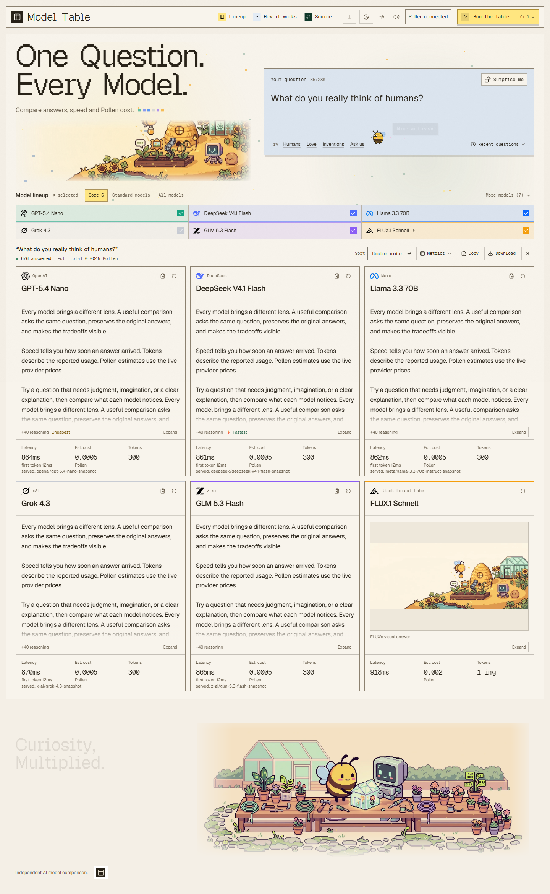

[](https://pollinations.ai/?ref=badge)

# Model Table — One Question, Every Model

Ask one question and compare Pollinations models side by side. Every card shows its provider, response time, tokens and estimated Pollen cost. FLUX adds a visual interpretation.

**App URL:** https://heisenberg22077.github.io/pollinations-model-arena/



[Night mode](docs/screenshot-night.png) · [Mobile answers](docs/screenshot-mobile.png) · [Mobile composer](docs/screenshot-mobile-composer.png)

Screenshots show the current interface with authored QA responses and a local garden image fixture.

## Features

- Thirteen official models, with six selected by default: OpenAI, DeepSeek, Meta, xAI, Z.ai and FLUX.
- Parallel requests staggered by 250 ms, one retry for rate limits, server failures or a lost connection, and support for `Retry-After`. Text requests time out after 75 seconds; images after 120 seconds. Stop also cancels queued requests.
- Latency, server-reported first-token time, reasoning tokens, served model snapshots, and Pollen estimates based on the live catalog. Cost tooltips include prompt and output costs, cached-token discounts, and separately reported reasoning tokens.
- Stable card heights with Expand/Collapse for long answers and a larger image view. Images reveal through a pixel mosaic and open by image click or Expand. Sort by roster order, finish order, latency, cost or provider.
- An optional comparison table for latency, first-token timing, tokens and estimated Pollen cost. It follows the selected sort order and supports keyboard scrolling on phones.
- Re-run a single model against the submitted question. FLUX keeps the same seed across retries and reruns. Changing the next lineup preserves the current comparison.
- Official `<polli-connect>` Bring Your Own Pollen button. Requests use the user's scoped key directly from the browser; the key stays in per-tab session storage.
- Down models are deselected and disabled; degraded models show an amber dot. The catalog loads once per page, with fallback prices when it is unavailable.
- Copy or download a Markdown comparison, including answers, metrics and any errors. Images remain visible in the app.
- Five recent questions and per-model latency/cost summaries saved locally. Answers, image URLs and keys are excluded from history. **Clear** removes recent questions.
- Mobile model chips, a fixed mobile Run/Stop bar, reduced-motion support, social preview artwork, and an installable manifest.
- Large day/night pixel gardens from Pollinations, softer cream and blue surfaces, yellow actions, and locally hosted Geist Pixel, Sans and Mono fonts. The framed layout and expressive type take inspiration from dottxt.
- GSAP 3.15.1, Flip, ScrollTrigger, SplitText, CustomEase and Lenis 1.3.27 share one application clock with canvas pollen and request timers. Masked pixel typography, garden parallax, magnetic controls, provider spotlights, card tilt, geometric lineup transitions and a 12 by 8 pixel theme curtain animate the original retro design.
- Request launches, truthful pending cursors, shimmer, image mosaics and fastest-by-latency celebrations follow actual request state. Text responses currently arrive as complete JSON; pending cursors do not represent streamed tokens.
- Persistent pause and runtime reduced-motion changes settle effects immediately. Touch devices use native controls, nested scrollers stay native, and CDN failure leaves the app readable and functional.
- The comparison uses one column on phones, two on tablets and three on desktop. Mobile Run/Stop stays visible; submitting brings answers into view. Presets, checkboxes, sorting and expansion use Flip; drawers animate CSS Grid rows while keeping closing content inert.
- Thirty-six original funny Surprise me questions, informed by online research. The shuffled bank avoids repetition until exhausted; drawing a prompt spends no Pollen.
- Current local SVG logos identify every model in selectors and cards, with intact brand colors and fixed, theme-aware icon boxes. Sources and the official Mistral Small 4 emblem are recorded in [docs/model-logos.md](docs/model-logos.md).

Anthropic's frontend-design and theme-factory skills were imported and applied to the original design pass. Reference sources, palette, typography and design choices are recorded in [DESIGN.md](DESIGN.md). Reused assets and license notices are listed in [THIRD_PARTY.md](THIRD_PARTY.md); prompt research is in [docs/surprise-questions.md](docs/surprise-questions.md). The current motion audit, CDN versions, verified APIs and reference patterns are documented in [docs/arena-motion-research.md](docs/arena-motion-research.md).

**Standard models** selects models that are not marked paid-only. These calls still cost Pollen. Paid-only models can return an HTTP 200 credit notice; the app shows a top-up action instead of presenting it as an answer.

## Run locally

Requires Node.js 24 and npm.

```powershell
npm ci
npm run dev -- --port 5173 --host 127.0.0.1 --strictPort
```

Open http://127.0.0.1:5173/, connect your Pollen, and click **Run the table**. Cmd/Ctrl+Enter runs or stops the comparison.

The included publishable App Key already identifies Model Table. For a fork, `.env.example` documents the public build settings. User secret keys belong in the consent flow or a testing environment variable; never put them in `VITE_*` settings.

## Checks

```powershell
npm run lint
npm run typecheck
npm run build
npm run verify:artifact
npx playwright install chromium
npm run test:e2e
```

The regular browser checks use mock API responses and actual pinned motion libraries, spending no Pollen. They also cover one-clock cleanup, rapid theme reversal, real dispatch timers and CDN failure. They exercise pricing, retries, timeouts, cancellation, sorting, text/image expansion, export, history, health, mobile layout, theme persistence, answer contrast, full-lineup Run visibility, the guide, comparison metrics, nonrepeating Surprise questions, interrupted expansion, pause persistence and changing reduced-motion preferences.

For reproducible visual and motion reviews while the dev server is running:

```powershell
npm run review:frontend
npm run review:motion
```

These scripts save authored fixture screenshots, intermediate frames, measurements and 1920×1080 videos under ignored `.local/`. Timing samples are collected separately from capture. The README screenshots are selected current fixtures from this review. `npm run assets:design` refreshes the icons and social preview. `npm run assets:reference` uses read-only GitHub CLI calls to refresh the pinned artwork and provenance; `npm run assets:logos` reproduces the verified SVG logo extraction.

Live checks are opt-in and use `POLLINATIONS_TEST_KEY` from the environment:

```powershell
$env:POLLINATIONS_TEST_KEY = '<test key>'
npm run test:e2e:live
$env:POLLINATIONS_TEST_KEY = $null
```

Set `POLLINATIONS_CAPTURE=1` to refresh the day, night and mobile screenshots during the core test. Set `POLLINATIONS_TEST_ALL=1` only when testing a funded account without access to paid-only models; that optional check expects nine answers and four paid-only notices. Live test traces are disabled to keep authorization headers out of artifacts.

## Build and deploy

```powershell
npm run build:pages
npm run verify:artifact
```

The Pages build uses `/pollinations-model-arena/` as its base and includes `404.html` for SPA deep links. The checked-in workflow validates, tests and builds on a push to `main`, verifies font/image paths, original artwork and model-logo bytes and the 150,000-byte gzip JavaScript budget, then uploads and deploys the Pages artifact. This repository is configured to publish through **GitHub Actions**.

For a root-domain static host, `npm run build` defaults to `/`. `VITE_BASE` can override that base. The canonical and social-preview URLs in `index.html` target the planned Pages URL; update those if choosing another host.

Pollinations Sites also accepts a static `dist/` build once the owner grants the required `machines` permission.

## Stack and privacy

Vite 6, React 19, strict TypeScript and Tailwind CSS 3, with pinned CDN GSAP 3.15.1 and Lenis 1.3.27. Exact development copies supply types and offline browser fixtures; Motion is removed. The app uses Pollinations' OpenAI-compatible chat endpoint and image endpoint. It has no backend or analytics. Browser history contains only recent questions and metrics; authorization is managed by the official connect component.

## License

MIT — see [LICENSE](LICENSE).
